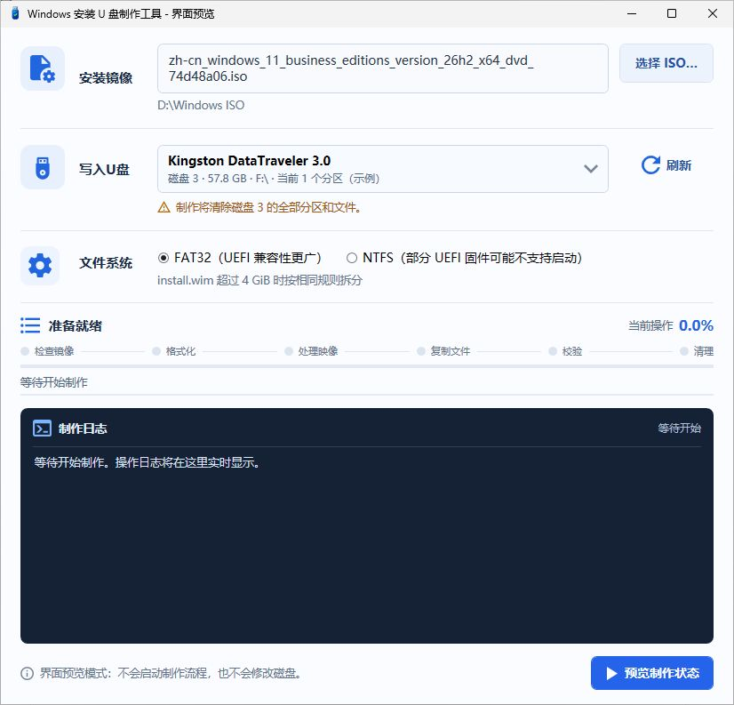

<div align="center">
  
  <h1>Win11Usb</h1>
  <p><strong>Windows installation USB creator</strong></p>
  <p>Choose an ISO and a USB disk. Follow the job in one window.<br>Full-capacity FAT32 · Automatic WIM splitting · Offline creation · Live progress</p>
  <p>
    <a href="https://github.com/kaixinit/Win11Usb/releases/tag/v0.1.0-beta.3"></a>
    
    <a href="https://github.com/kaixinit/Win11Usb/actions/workflows/windows.yml"></a>
    <a href="LICENSE"></a>
  </p>
  <p>
    <a href="https://github.com/kaixinit/Win11Usb/releases/download/v0.1.0-beta.3/Win11Usb-v0.1.0-beta.3-windows-x64.zip"><strong>Download Windows x64 · beta.3</strong></a>
    &nbsp;·&nbsp; <a href="https://github.com/kaixinit/Win11Usb/releases">All releases</a>
    &nbsp;·&nbsp; <a href="README.md">中文</a>
  </p>
</div>

> **Creating media erases every partition and file on the selected USB disk.** Back up first and verify its disk number, model and capacity in the final confirmation. This is a pre-release.

## See what is happening

Follow six stages, overall and current-file progress, and scrolling logs in one window.


*Screenshots show the actual application's preview mode with sample devices and simulated progress. They are not evidence of a real-media job or boot test.*

<details>
<summary>More screenshots: source selection and final confirmation</summary>




</details>

## Why Win11Usb

| Feature | What it does |
| --- | --- |
| **Full-capacity FAT32 on large USB disks** | Erase an existing NTFS or multipartition PE USB disk and rebuild one FAT32 partition using the available capacity. Use the bundled compatibility formatter when needed, instead of shrinking the partition to about 31 GB. |
| **Automatic large-WIM handling** | Split install.wim locally into SWM files when it exceeds 4,294,967,295 bytes, then copy them. NTFS follows the same rule. |
| **Portable and offline** | One EXE, no extra runtime installation. Choose an existing Windows ISO; the program mounts and identifies it. Media creation needs no network. |
| **Visible progress and results** | Six stages, overall/file progress and live logs. Compare copied file lengths, then optionally clean temporary files and eject the USB disk and ISO. |

The full-capacity FAT32 workflow supports USB disks up to 2 TiB. Its compatibility-formatting branch for disks over 32 GB still needs current-version real-media testing. **This erases and rebuilds the disk; it is not an in-place conversion that preserves files.**

System, boot, offline and read-only disks are excluded. Device identity, partition layout and source locations are rechecked before creation. The ISO, program and temporary files must not be on the target. These checks do not replace backups or manual verification.

## Download

Choose the **Windows x64 runtime ZIP**, extract it and run Win11Usb.exe.

| File | Contents |
| --- | --- |
| **[Windows x64 runtime](https://github.com/kaixinit/Win11Usb/releases/download/v0.1.0-beta.3/Win11Usb-v0.1.0-beta.3-windows-x64.zip)** | Portable EXE, documentation, licenses and corresponding third-party source. |
| [Project source](https://github.com/kaixinit/Win11Usb/releases/download/v0.1.0-beta.3/Win11Usb-v0.1.0-beta.3-source.zip) | Source code, build scripts, tests and GitHub configuration. |
| [SHA-256 checksums](https://github.com/kaixinit/Win11Usb/releases/download/v0.1.0-beta.3/SHA256SUMS.txt) | Checksums for both ZIPs; the runtime package also has an EXE checksum. |

## Create installation media

Prepare a local Windows 10/11 x64 installation ISO and a backed-up USB disk of at least 8 GiB, large enough for the installation files.

1. Extract the runtime ZIP, run Win11Usb.exe and accept the administrator prompt.
2. Choose the ISO, verify the physical USB disk and select FAT32 or NTFS. Usually prefer FAT32.
3. Start creation, check the disk number, model and capacity, then explicitly confirm the whole-disk erase.
4. Follow progress through image checks, formatting, image processing, copying, verification and cleanup. Choose whether to clean temporary SWM files and eject the USB disk and ISO.

The application targets Windows 10/11 x64 and x64 UEFI installation media. FAT32 is generally preferred for firmware compatibility. Some UEFI firmware cannot boot directly from NTFS. This is not a multiboot or Windows activation tool. Copy verification compares file lengths, not cryptographic hashes of all files.

<details>
<summary>Developers: build and preview</summary>

Build and run the non-destructive regression suites in Windows PowerShell 5.1:

```powershell
powershell.exe -NoProfile -ExecutionPolicy RemoteSigned -File .\build\Build-Win11Usb.ps1
powershell.exe -NoProfile -STA -ExecutionPolicy RemoteSigned -File .\tests\Run-Tests.ps1
```

Build from the source package with the Windows .NET Framework C# compiler. Output: dist/Win11Usb.exe. The C# WPF interface starts without a PowerShell runspace; the worker runspace starts after user confirmation. The standard application manifest requests administrator rights. Native tools such as DISM and robocopy run as child processes during creation. --preview, --preview-running and --preview-empty never mount an ISO or modify disks.

[Architecture](docs/ARCHITECTURE.md) · [Contributing](https://github.com/kaixinit/Win11Usb/blob/main/CONTRIBUTING.md)

</details>

## Validation and limits

**beta.3 passed GitHub Windows builds and all 11 regression suites.** A user-provided real-media log covers a 14.6 GB Lenovo USB disk, FAT32, large-WIM splitting, file-length verification, cleanup and eject; the user reported no antivirus alerts during the job. UEFI boot, real-media NTFS, Windows 10 and the wider hardware/DPI matrix remain unverified.

The EXE is unsigned. Older beta.1 and beta.2 packages are withdrawn. Local scans and one user's result do not establish universal antivirus or firmware compatibility. See the [validation record and redacted log](docs/VALIDATION.md), [FAQ, in Chinese](docs/FAQ.md) and [security policy](https://github.com/kaixinit/Win11Usb/blob/main/SECURITY.md).

## Feedback and contributions

[Report an issue](https://github.com/kaixinit/Win11Usb/issues) with the version, Windows build, failed stage and a redacted log. Hardware and firmware compatibility reports are welcome. If Win11Usb is useful to you, a **Star** helps others discover it.

Original project code: [MIT](LICENSE). The separate fat32format executable and corresponding source retain their GPL terms; see [notices](THIRD_PARTY_NOTICES.md). No Windows ISO or installation binaries are distributed with this project.
