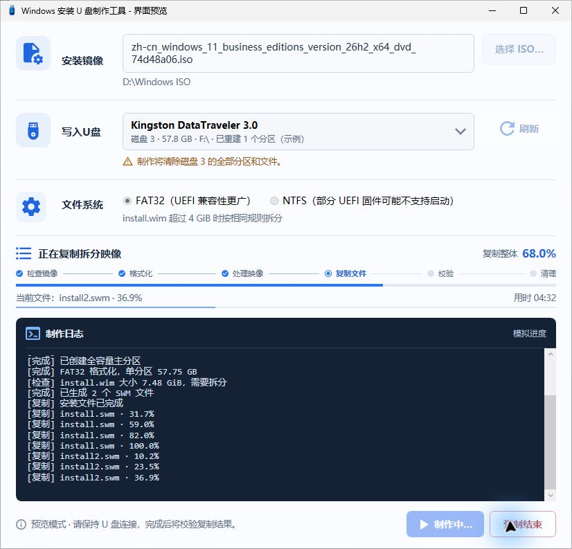

# Win11Usb — Windows installation USB creator

A portable Windows desktop tool for turning a local Windows ISO into installation media. Choose an ISO, select the physical USB disk, review the destructive confirmation, and follow progress and logs in one window.

[中文](README.md) · [Validation](docs/VALIDATION.md) · [Third-party notices](THIRD_PARTY_NOTICES.md)

**0.1.0-beta.3 is a pre-release candidate.** Creating media deletes all partitions and files on the selected USB disk. Back up first and verify its disk number, model and capacity.

The C# entry point now creates the existing WPF interface directly, preserving the worker and media-creation engine. The user reports that beta.3 opened and completed a FAT32 / large-WIM job without antivirus alerts on the previously affected computer. Eleven local regression suites passed. This does not establish universal antivirus or firmware compatibility; see [validation and the redacted log](docs/VALIDATION.md). Older beta.1 and beta.2 packages are withdrawn.



- Automatic mounting of a user-selected local ISO.
- Whole-disk rebuild into one full-capacity FAT32 or NTFS partition.
- WIM splitting only above 4,294,967,295 bytes; the same rule applies to NTFS.
- Device snapshot checks, source/dependency protection and explicit final format confirmation.
- Separate overall/file progress, scrolling logs, size verification and optional media eject.

The application targets Windows 10/11 x64 and x64 UEFI installation media. FAT32 is generally preferred for firmware compatibility. Some UEFI firmware cannot boot directly from NTFS. This is not a multiboot or Windows activation tool. Copy verification compares file lengths, not cryptographic hashes of all files.

Build and run the non-destructive regression suites in Windows PowerShell 5.1:

```powershell
powershell.exe -NoProfile -ExecutionPolicy RemoteSigned -File .\build\Build-Win11Usb.ps1
powershell.exe -NoProfile -STA -ExecutionPolicy RemoteSigned -File .\tests\Run-Tests.ps1
```

Build from the source package with the Windows .NET Framework C# compiler. Output: dist/Win11Usb.exe. The C# WPF interface starts without a PowerShell runspace; the worker runspace starts after user confirmation. The standard application manifest requests administrator rights. Native tools such as DISM and robocopy run as child processes during creation. --preview, --preview-running and --preview-empty never mount an ISO or modify disks.

The runtime ZIP includes the portable EXE, documentation, licenses and corresponding third-party source. The source ZIP includes the project, build scripts, tests and GitHub configuration. SHA256SUMS.txt identifies the two ZIPs; the runtime package contains a separate checksum for its EXE. The EXE is unsigned. Hardware evidence currently covers one 14.6 GB Lenovo USB disk, FAT32, WIM splitting and eject; UEFI boot, NTFS on real media and the wider hardware/DPI matrix remain unverified.

Original project code: [MIT](LICENSE). The separate fat32format executable and corresponding source retain their GPL terms; see [notices](THIRD_PARTY_NOTICES.md). No Windows ISO or installation binaries are distributed with this project.
