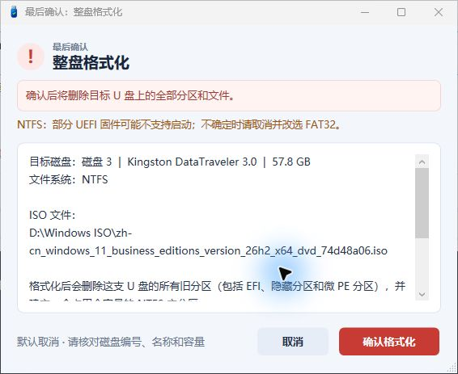

# Windows 安装 U 盘制作工具 · Win11Usb

选择一个 Windows ISO，按提示制作安装 U 盘。单文件 EXE，本机处理，无需下载运行库或联网制作。

[English](README.en.md) · [使用与常见问题](docs/FAQ.md) · [验证范围](docs/VALIDATION.md) · [发布说明](docs/RELEASE_NOTES.md)

当前版本：**0.1.0-beta.3 · 预发布**。运行前请阅读下方制作说明和验证范围。

[下载 beta.3](https://github.com/kaixinit/Win11Usb/releases/tag/v0.1.0-beta.3) · [问题反馈](https://github.com/kaixinit/Win11Usb/issues)

beta.3 改由 C# 直接启动 WPF 界面，保留现有制作引擎。用户已在此前报毒的电脑上完成一次 FAT32 大 WIM 制作，并反馈全程未报毒；本地 11 组回归也已通过。验证范围、脱敏实测日志及旧版检测记录见 [验证记录](docs/VALIDATION.md)。旧 beta.1 / beta.2 已撤回，不再作为下载版本。


## 适合什么场景

- 手头已有 Windows 10 / 11 x64 安装 ISO，希望通过窗口选择文件并自动挂载。
- U 盘曾做过 PE 维护盘，存在多个盘符、EFI 或隐藏分区，需要恢复成一个全容量安装分区。
- install.wim 超过 FAT32 单文件限制，希望按大小自动判断是否需要拆分。
- 希望看见当前阶段、整体与当前文件进度，以及可保留的制作日志。

工具按**整支物理磁盘**操作。制作会删除选中 U 盘的全部分区和文件，请先备份，并在最终确认框中核对磁盘编号、名称与容量。

## 使用

1. 从发布包取出 Win11Usb.exe，运行并确认 Windows 管理员权限提示。
2. 选择本地 Windows ISO，选择“写入U盘”中的目标整盘。
3. 选择 FAT32 或 NTFS。通常优先选择 FAT32；部分 UEFI 固件可能不支持直接从 NTFS 启动。
4. 点击“开始制作”，核对检查信息，再单独确认整盘格式化。默认取消。
5. 程序识别映像、重建分区、按需拆分、复制并检查文件大小。结束后可清理临时 SWM，选择是否安全弹出 U 盘与 ISO。



NTFS 也沿用相同拆分规则：install.wim 大于 **4,294,967,295 字节**才拆分。DISM 使用 /FileSize:4000，生成多少个分卷由实际内容决定，每个生成文件还会再检查大小。所有分卷复制到 sources 目录。FAT32 与 SWM 的背景见 [Microsoft 安装介质说明](https://learn.microsoft.com/en-us/windows-hardware/manufacture/desktop/install-windows-from-a-usb-flash-drive?view=windows-11) 和 [映像拆分说明](https://learn.microsoft.com/en-us/windows-hardware/manufacture/desktop/split-a-windows-image--wim--file-to-span-across-multiple-dvds?view=windows-11)。

## 制作前会核对什么

程序排除系统盘、启动盘、离线和只读磁盘；核对界面选择快照、设备身份、分区布局、源 ISO、运行程序和临时目录所在磁盘。ISO 或程序放在准备清空的 U 盘上时会停止。无法确认身份、格式化结果或复制大小时，也会停止后续步骤。

这些检查不能替代备份与人工核对。进度为阶段进度；复制整体按字节估算。最终校验为**文件大小校验**，没有宣称对每个安装文件进行密码学哈希校验。

## 环境与限制

- 面向 Windows 10 / 11 x64，依赖系统自带 Windows PowerShell 5.1、WPF、Storage、DISM 与 robocopy。
- USB 容量至少 8 GiB，本流程重建 MBR 单分区，上限 2 TiB；实际所需容量由 ISO 大小决定。
- 安装介质需要 efi/boot/bootx64.efi、sources/boot.wim 和 setup.exe，主要面向 x64 UEFI 安装。
- 识别和卷标以安装映像索引 1 为依据；多版本 ISO 不表示只安装此版本。发行版本可能用 ISO 文件名辅助判断，不能验证错误重命名。
- 不是多系统引导工具；不下载 Windows、不提供激活，也不承诺适用于所有固件。
- 强制结束会关闭程序，U 盘可能需要重新制作；自动挂载的 ISO 可能保留。
- 当前未签名。Defender 单次文件扫描、模拟测试与实机启动验证是不同的检查，见 [验证记录](docs/VALIDATION.md)。

## 从源码构建

在仓库根目录的 Windows PowerShell 5.1 中运行：

```powershell
powershell.exe -NoProfile -ExecutionPolicy RemoteSigned -File .\build\Build-Win11Usb.ps1
powershell.exe -NoProfile -STA -ExecutionPolicy RemoteSigned -File .\tests\Run-Tests.ps1
```

下载源码包后，在仓库根目录构建。输出为 dist/Win11Usb.exe。使用 Windows 自带 .NET Framework C# 编译器，构建不需要 PS2EXE、Node.js 或 NuGet。C# 直接创建界面，通过标准应用清单请求管理员权限；用户确认开始后才在同进程后台托管制作 Runspace。制作时仍会调用系统 DISM、robocopy 等命令。

```powershell
.\dist\Win11Usb.exe --self-check
.\dist\Win11Usb.exe --preview
.\dist\Win11Usb.exe --preview-running
.\dist\Win11Usb.exe --preview-empty
```

预览使用示例数据，不挂载 ISO、不运行制作引擎、不修改磁盘。正式制作中的 FAT32 兼容工具会解压到本次本地工作目录。

## 下载文件如何选择

- windows-x64.zip：运行包，包含单文件 EXE、使用说明、第三方许可与对应源码；无需安装。
- source.zip：项目源码、构建脚本、测试及 GitHub 配置。
- SHA256SUMS.txt：两个 ZIP 的 SHA-256 清单；运行包内另有 EXE 清单，用于核对文件是否一致。

当前实机证据覆盖一支 14.6 GB Lenovo U 盘、FAT32、大 WIM 拆分和安全弹出；从 U 盘进入安装程序、NTFS 实机、更多硬件及 DPI 仍需补测。先按 Pre-release 使用，不把一次成功等同于完整兼容认证。

## 反馈与许可证

请用 Issue 模板提供版本、系统构建号、出错阶段及脱敏日志。日志可能含个人路径、磁盘信息，公开前请检查。

项目原创代码按 [MIT](LICENSE) 许可。独立运行的 Ridgecrop fat32format 及其原始源码保留 GPL 声明，不改标为 MIT；配套源码、许可与哈希见 [第三方说明](THIRD_PARTY_NOTICES.md)。图标已替换为本项目原创生成资产，并提供来源记录。
