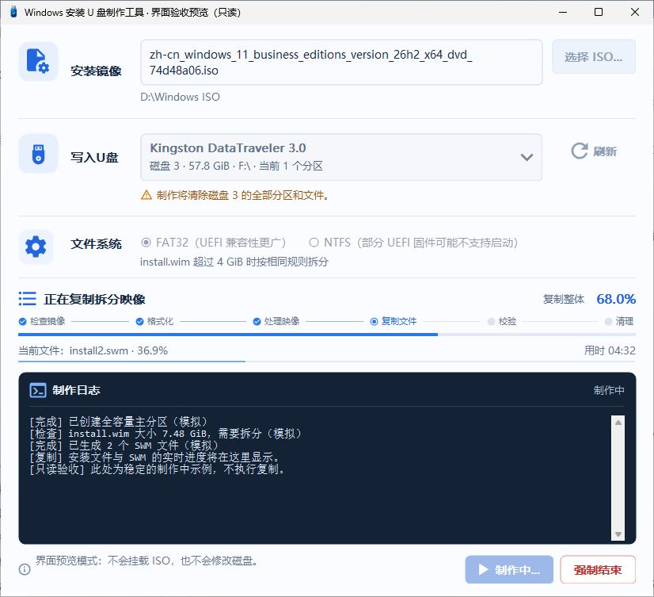
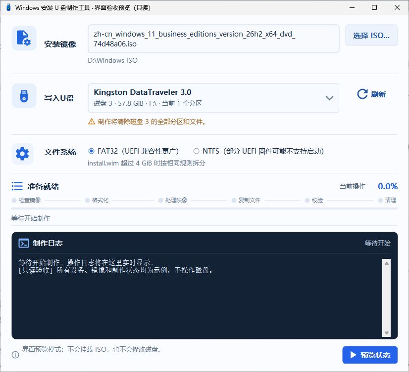
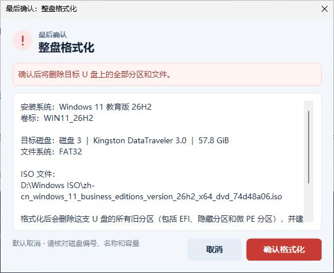

<div align="center">
  
  <h1>Win11Usb</h1>
  <p><strong>把 Windows ISO，做成一支安装 U 盘。</strong></p>
  <p>C++ / Win32 原生 · 无 .NET · 无 PowerShell · 单文件免安装<br>全容量 FAT32 · 大 WIM 自动拆分 · 本地离线制作</p>
  <p>
    <a href="https://github.com/kaixinit/Win11Usb/releases/tag/v0.2.0-preview.14"></a>
    
    <a href="LICENSE"></a>
  </p>
  <p>
    <a href="https://github.com/kaixinit/Win11Usb/releases/download/v0.2.0-preview.14/Win11Usb-v0.2.0-preview.14-windows-x64.exe"><strong>↓ 下载原生版 EXE · Windows x64</strong></a>
    &nbsp;·&nbsp; <a href="https://github.com/kaixinit/Win11Usb/releases/tag/v0.2.0-preview.14">版本说明</a>
    &nbsp;·&nbsp; <a href="README.en.md">English</a>
  </p>
</div>

> **制作会清空所选 U 盘的全部分区和文件。** 请先备份，并在最终确认框核对磁盘编号、名称与容量。原生版目前为预发布，beta.3 仍独立保留。

## 一个窗口，完成制作

选好 ISO 和 U 盘，跟随六阶段进度完成制作。整体进度、当前文件和滚动日志同时显示；复制期间合并刷新，减少界面闪烁。



*截图为实际原生程序界面的只读预览，使用示例设备和模拟进度，不是实机写盘或启动成功的证明。*

<details>
<summary>查看主界面与格式化确认弹窗</summary>

**选择 Windows ISO、整支 U 盘和文件系统**



**清盘前单独确认，默认取消**



</details>

## 产品特色

| 特色 | 能帮你做什么 |
| --- | --- |
| **原生运行，无 .NET、无 PowerShell** | C++ / Win32 界面与制作后端，不加载 CLR、WPF 或 PowerShell；无需另装 .NET、VC++ 运行库或 WebView。 |
| **一个 EXE，免安装、离线制作** | 下载即可运行。手动选择本地 Windows ISO，由程序自动只读挂载并识别映像；制作无需联网。 |
| **大容量 U 盘，全容量 FAT32** | 将原 NTFS 或多分区 U 盘清空后，重建一个全容量 FAT32 分区，避免只使用约 32 GB。已收到 57.8 GiB Kingston 的完整实机通过日志。 |
| **大 WIM 自动拆分** | `install.wim` 超过 4,294,967,295 字节时，先在本机拆为 SWM 再复制。FAT32、NTFS 都沿用相同规则。 |
| **复制后，逐块比较内容** | 刷新缓存，检查文件大小并逐块比较源文件与 U 盘文件内容，复核关键 x64 UEFI 文件；校验过程显示进度。 |
| **收尾有结果** | 制作后可选择清理本次临时 SWM、安全弹出 U 盘与 ISO。弹出失败会准确提示，保留已完成的制作结果。 |

全容量 FAT32 流程支持 **8 GiB–2 TiB** USB 磁盘，容量包含正常分区对齐与文件系统开销。**这是清空后重建，不是保留文件的无损转换。**

## 下载与版本选择

| 下载 | 用途 |
| --- | --- |
| **[原生版单文件 EXE](https://github.com/kaixinit/Win11Usb/releases/download/v0.2.0-preview.14/Win11Usb-v0.2.0-preview.14-windows-x64.exe)** | `v0.2.0-preview.14`，Windows x64，直接运行，无需安装。 |
| [原生版配套资料 ZIP](https://github.com/kaixinit/Win11Usb/releases/download/v0.2.0-preview.14/Win11Usb-v0.2.0-preview.14-windows-x64.zip) | 同一 EXE、说明和第三方源码/许可，便于完整保存与转发。 |
| [项目源码 ZIP](https://github.com/kaixinit/Win11Usb/releases/download/v0.2.0-preview.14/Win11Usb-v0.2.0-preview.14-source.zip) · [SHA-256 校验清单](https://github.com/kaixinit/Win11Usb/releases/download/v0.2.0-preview.14/SHA256SUMS.txt) | 构建、审查或核对发布文件。 |
| [保留的 beta.3](https://github.com/kaixinit/Win11Usb/releases/tag/v0.1.0-beta.3) | 原有 C# / WPF / PowerShell 版本，文件和发布记录保持独立。 |

**新版不会自动覆盖旧版。** 两版使用不同版本号、发布标签与 EXE 文件名，可放在不同文件夹中保留；程序没有自动更新机制。不要同时对同一支 U 盘执行制作。

## 开始制作

准备本地 Windows 10 / 11 x64 安装 ISO，以及一支已备份、容量足够且至少 8 GiB 的 USB 磁盘。

1. 运行原生版 EXE，确认 Windows 管理员权限提示。
2. 选择 ISO，在“写入U盘”中核对目标整盘；通常优先选择 FAT32。
3. 点击“开始制作”。程序挂载并检查 ISO；核对最终确认中的磁盘身份、清盘范围与文件系统，再确认格式化。
4. 拆分、复制和内容校验会自动继续，可在同一窗口查看进度和日志。
5. 制作完成后，按需清理临时 SWM，选择是否安全弹出 U 盘与 ISO。

部分 UEFI 固件可能不支持直接从 NTFS 启动；程序不会自动改选 NTFS。SWM 分卷使用 DISM `/FileSize:4000`，实际分卷数由映像内容决定，每卷都会再检查大小与编号。内容校验会多读取一次源文件及目标文件，不是介质寿命或坏块检测。

<details>
<summary>系统要求、临时文件与兼容性</summary>

- 面向 **Windows 10 / 11 x64**，安装介质主要面向 x64 UEFI；不宣称支持 Legacy BIOS、ARM64 或 WinPE。
- 无 .NET、无 PowerShell，不代表删除任意系统组件后仍能使用。界面需要 Win32 桌面、GDI+、SetupAPI 和存储驱动；制作使用系统 ISO/WIM 接口，拆分使用 `dism.exe`，NTFS 格式化使用 `format.com`。精简 Windows 需保留所选流程必需组件。
- “单文件”指分发时只需一个 EXE。运行时会创建本次日志、临时 SWM，并提取独立 FAT32 工具及对应源码/许可；本地磁盘需有足够空间。
- 程序排除系统/启动盘、离线和只读设备，复核设备身份、分区布局及路径。ISO、运行程序或临时目录位于目标盘时停止；这些检查不能代替备份和人工核对。
- 安装映像以索引 1 识别；多版本 ISO 不表示只安装此版本。发行版本可能用文件名辅助判断，不能验证同系列 ISO 被错误重命名。
- 强制结束可能使 U 盘需要重新制作；自动挂载的 ISO 也可能保留。日志存于本次任务目录，可用窗口“导出诊断”排查。
- 不下载 Windows、不提供激活，也不是多系统引导工具。

</details>

## 已验证到哪一步

原生版已通过 **962 项自动化断言**，以及生产界面的 **5,000 条日志 / 10,000 次进度更新**测试。PE 检查确认 x64 原生程序、无 CLR；实时保护开启时，Defender 文件扫描未检出。

用户收到 preview.14 后提供的完整日志记录：**Kingston 57.8 GiB 全容量 FAT32 / 32 KiB 簇、57.7 GiB 可用，2 个 SWM，1,067 个文件复制与内容校验，临时 SWM 清理、USB 和 ISO 弹出全部成功。** 日志本身未记录版本及 EXE 哈希，结论限于该次配置。

实际 UEFI 启动、NTFS 实机和更多设备/系统仍待补测；文件扫描不等于完整制作动态检测或所有杀毒软件兼容。EXE 当前未签名，因此保持 **Pre-release**。[原生验收记录](native/ACCEPTANCE.md) · [USB 弹出修复与复测](native/USB-EJECT-preview14.md) · [beta.3 历史验证](docs/VALIDATION.md)

<details>
<summary>开发者：构建原生版</summary>

原生源码位于 `native/`。使用 llvm-mingw，在仓库根目录的命令提示符中执行：

```bat
native\build.cmd "C:\path\to\llvm-mingw\bin" full
native\test.cmd "C:\path\to\llvm-mingw\bin"
native\test-ui.cmd "C:\path\to\llvm-mingw\bin"
```

制作版输出为 `dist\Win11Usb-NativeReview-v0.2.0-preview.14.exe`，发布时采用上表中的版本化文件名。省略 `full` 可构建不链接制作后端的只读验证版；支持只读设备诊断、`--eject-report` 和示例界面预览。

构建也不需要 PowerShell。旧版 `src/`、`build/` 和对应脚本保留，用于 beta.3。[原生架构、依赖和构建细节](native/README.md)

</details>

## 反馈与许可

欢迎[提交 Issue](https://github.com/kaixinit/Win11Usb/issues)，附版本、Windows 构建号、出错阶段和脱敏日志。也欢迎反馈 U 盘与固件启动结果，帮助补齐兼容性记录。公开日志前，请检查个人路径和设备信息。

如果 Win11Usb 对你有帮助，欢迎点一个 **Star**，让更多需要制作安装 U 盘的人找到它。

原创代码采用 [MIT](LICENSE)。独立 FAT32 工具及对应源码保留 GPL；界面矢量图标保留 Apache 2.0，静态运行库保留各自许可。详见 [第三方说明](THIRD_PARTY_NOTICES.md) 与 [原生运行库许可](native/third_party/RUNTIME-LICENSES.txt)。项目不分发 Windows ISO 或安装文件。
